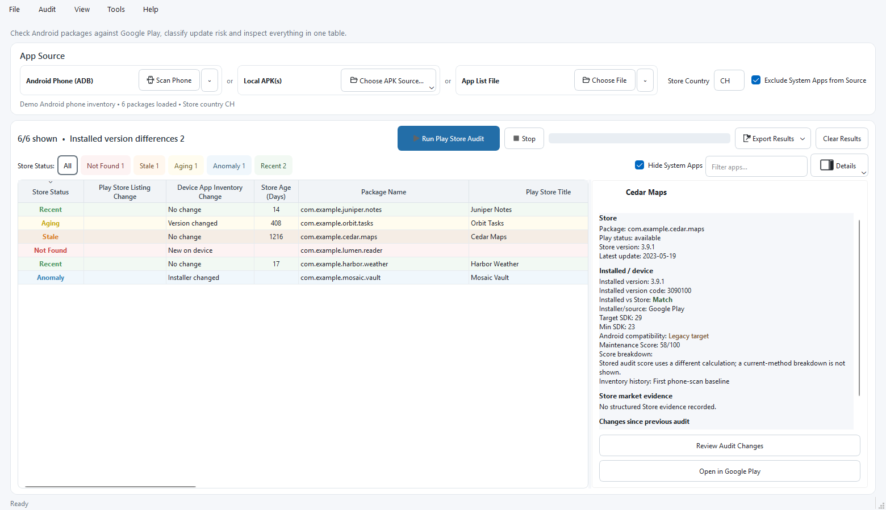

# Store App Audit _(PlayStoreAppAudit)_

[](https://github.com/sponsors/mrc-labs)

Desktop utility for auditing Android package IDs against public Google Play listings.

Review Store availability, update dates and maintenance signals for app lists, local APK files and connected Android phones. Built with Python and Qt/PySide6; not affiliated with Google. The visible name is Store App Audit; the repository/executable slug remains `PlayStoreAppAudit` and the Python project is `playstore-app-audit` for compatibility.

**Latest published release:** [v2.4.0](https://github.com/mrc-labs/PlayStoreAppAudit/releases/tag/v2.4.0). Maintenance, security and native compatibility updates; see the [changelog](CHANGELOG.md).

## Table of Contents

- [Install](#install)
- [Usage](#usage)
- [Features](#features)
- [Screenshots](#screenshots)
- [Development](#development)
- [Maintainers](#maintainers)
- [Contributing](#contributing)
- [License](#license)

## Install

Download the ZIP matching your system from [GitHub Releases](https://github.com/mrc-labs/PlayStoreAppAudit/releases/latest), extract it and launch the application. Packaged builds do not require Python.

| System | Native architectures | Distribution |
| --- | --- | --- |
| Windows | x64, ARM64 | Unsigned |
| Linux | x64, ARM64 | Unsigned |
| macOS | Intel/x64, Apple Silicon/ARM64 | Engineering ad-hoc signed; not notarized |

Windows x64 extraction example:

```powershell
Expand-Archive .\PlayStoreAppAudit-v2.4.0-windows-x64.zip -DestinationPath .
```

Verify downloads against the release's `SHA256SUMS.txt`. Unsigned or non-notarized applications may require explicit OS approval. See [Project Status](docs/PROJECT_STATUS.md) for compatibility requirements and tested systems.

## Usage

1. Open the extracted `PlayStoreAppAudit.exe`, `PlayStoreAppAudit` or `PlayStoreAppAudit.app`.
2. Import an app list, select local APK files/folders, or use **Scan Phone** with an authorized Android device.
3. Choose the Store country, run the audit and review or export the results.

### CLI

Run the packaged executable from its extracted directory; for example on Windows:

```powershell
.\PlayStoreAppAudit.exe cli audit app-list sample_packages.csv --country it --output results.json
```

Linux uses `./PlayStoreAppAudit`; macOS uses `./PlayStoreAppAudit.app/Contents/MacOS/PlayStoreAppAudit`. See the [usage guide](docs/USAGE.md) for CLI options, local APK workflows, ADB setup, privacy and troubleshooting.

## Features

- Audit CSV/TSV/TXT app lists, local APK/APKS/APKM/XAPK files and Android phone inventories.
- Review Store categories, update dates and conservative availability/version comparisons.
- Filter results, save source-specific layouts and compare audit history.
- Preview local APK renaming and review byte-identical duplicates before explicit cleanup.
- Export CSV, HTML or JSON; use the GUI or headless CLI.

Phone access through ADB is read-only for installed apps. Audits contact public Google Play endpoints; settings and history are stored locally. `Not Found` does not prove global removal, and Maintenance Score is not a malware/security rating.

## Screenshots



The screenshot shows the v2.1 interface with synthetic data. [Local APK screenshot](docs/images/store-app-audit-local-apk.png).

## Development

Use supported stable Python 3.14. From the repository root:

```bash
python -m pip install -r requirements-dev.txt
python main.py
python -m pytest
ruff check playstore_app_audit tests main.py
```

Prefer supported official packages, wheels and Actions; custom builds require a demonstrated need. See [Building](docs/BUILDING.md), [Architecture](docs/ARCHITECTURE.md), [component policy](docs/RELEASE_COMPONENT_FRESHNESS.md) and [Roadmap](docs/ROADMAP.md). Release provenance and verification are in the [v2.4.0 audit](docs/V2_4_RELEASE_PREP.md).

## Maintainers

MRC — [mrc-labs](https://github.com/mrc-labs).

## Contributing

Questions, bug reports and ideas are welcome in [Issues](https://github.com/mrc-labs/PlayStoreAppAudit/issues). Focused pull requests are welcome; follow [CONTRIBUTING.md](CONTRIBUTING.md), including the [CLA](CLA.md) requirement for material contributions. Do not publish credentials or private diagnostic data.

You can also [sponsor development](https://github.com/sponsors/mrc-labs).

## License

[GPL-3.0-only](LICENSE), owned by MRC and contributing copyright holders. Third-party components retain their respective licenses; see the notices included with each package.
